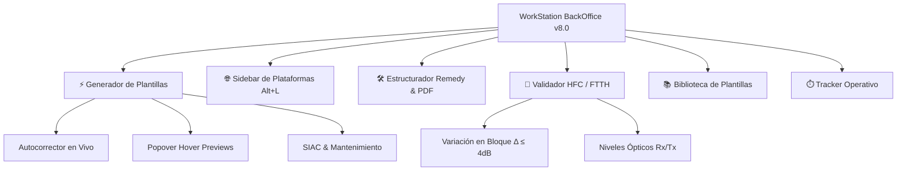

# 🚀 BackOffice WorkStation Suite — Versión 2.8

<div align="center">


**Plataforma Integral de Productividad, Diagnóstico Técnico en Tiempo Real y Generación Automatizada de Plantillas para BackOffice Telecom.**

[🌐 Probar en Vivo (GitHub Pages)](https://dreyeles.github.io/backoffice-workstation/) · [✨ Novedades v2.8.1](#-novedades-clave-de-la-versi%C3%B3n-281) · [📌 Módulos](#-m%C3%B3dulos-y-capacidades-principales) · [⌨️ Atajos de Teclado](#%EF%B8%8F-atajos-y-productividad)

</div>

---

## 🌟 Novedades Clave de la Versión 2.8.1

La versión **2.8.1** añade una experiencia visual de inspección avanzada con zoom tipo Amazon por clic y una depuración integral del catálogo de equipos:

### 1. 🔍 Zoom Interactivo Tipo Amazon por Clic
- **Activación por Clic:** Haz clic sobre la foto en el modal previsualizador para activar un zoom de aumento continuo centrado exactamente en el cursor.
- **Paneo y Rueda Dinámica:** Desplaza el mouse para inspeccionar puertos, botones y etiquetas. Modula el nivel de aumento con la rueda del ratón entre `1.5x` y `4.5x`.
- **Salida Cómoda:** Haz clic de nuevo, clic fuera o presiona <kbd>Escape</kbd> para salir suavemente del zoom.

### 2. 📁 Galería Fotográfica Estructurada por Modelo
- Organización limpia de las imágenes de los 22 modelos de routers y ONTs en carpetas individuales (`img/equipos/<MODELO>/`) con vistas frontal, lateral, posterior de puertos y etiqueta inferior.

### 3. 🧼 Depuración Integral y Ficha Técnica Sin Redundancias
- Eliminación de datos duplicados en el modal y corrección de la doble mención de TR-069 en la plataforma de revisión.
- Simplificación del rotulado técnico a simplemente `💾 Firmware`.

---

## 🌟 Novedades Previas (Versión 2.8)

La versión **2.8** incorporó el sistema de identificación y visualización técnica de equipos Claro, validación estricta de homologación con TR-069 y una arquitectura modular de alto rendimiento:

- **🛡️ Homologación Estricta TR-069:** Validación estricta donde solo se consideran homologados los equipos con soporte TR-069 activo.
- **🔍 Previsualizador Grande (Lightbox Modal):** Ficha técnica ampliada y galería multi-ángulo por modelo.
- **⚡ Arquitectura Modular en 13 submódulos (`js/core/`, `js/engines/`, `js/tabs/`):** Separación limpia por capas, mayor rendimiento y mantenimiento 100% offline.

---

## 🌟 Novedades Previas (Versión 2.7.2)

La versión **2.7.2** incorpora la homologación operativa oficial del **Flyer N° 41-BO FIJA (30/09/2026)** y optimizaciones ergonómicas de flujo rápido:

### 1. 📡 Homologación Oficial HFC — Flyer N° 41-BO FIJA (30/09/2026)
- **🚨 Decisión Directa en Potencia Upstream:** Si la *Potencia Upstream* está fuera de rango ($< 36.1$ o $> 52.9\text{ dBmV}$), el analizador genera de inmediato **`🚨 GENERAR VISITA TÉCNICA`** *(sin descartes)*.
- **📊 Regla Estricta Downstream:** Solo se genera Visita Técnica si **ambos niveles** (*D/S SNR* y *Potencia Downstream*) están fuera de rango simultáneamente (o si coinciden 2+ en la misma fila/canal). Si únicamente 1 parámetro se encuentra alterado de forma aislada, el sistema emite **`🔄 CONTINUAR DESCARTES REGULARES`** *(Ámbar)*.
- **🔄 Diagnóstico de U/S SNR:** Si el SNR de Upstream está fuera de rango ($< 28.0\text{ dB}$), el sistema orienta a **`🔄 CONTINUAR DESCARTES REGULARES`** sin generar visita técnica directa.
- **📋 Botón `📋 Pegar` Ultra-Rápido:** Inserción con 1 clic de lo último copiado en el portapapeles con auto-distribución y evaluación en tiempo real tanto para HFC como para FTTH.

---

## 🌟 Novedades Previas (Versión 8.0)

La versión **8.0** revoluciona la experiencia operativa con un ecosistema inteligente de asistencia en tiempo real, previsualizaciones flotantes, navegación lateral expandible y autocorrección contextual:

### 1. 👁️ Popover Flotante de Previsualización en Vivo (*Live Preview Glassmorphism*)
- **Inspección Previa Sin Clics:** Al posar el cursor sobre cualquier botón de descarte rápido (*Ciclo de llamada, Cliente conforme, Visita técnica, etc.*), aparece un popover flotante inteligente con diseño *glassmorphism* que muestra con precisión el texto exacto a insertar.
- **Cálculo Dinámico de Vista:** Ubicado en la raíz del DOM (`body`) con detección de bordes para evitar desbordamientos y asegurar un posicionamiento perfecto en cualquier resolución.

### 2. 🔤 Motor de Autocorrección Ortográfica y Abreviaturas Técnicas
- **Corrección en Tiempo Real:** Corrige automáticamente tildes, faltas ortográficas recurrentes y expande abreviaturas técnicas de telecomunicaciones mientras el asesor escribe.
- **Tipeo Fluido & Preservación de Cursor:** Algoritmo que respeta los espacios naturales, saltos de línea y la posición exacta del cursor en todo momento.
- **Soporte para Pegado (`Ctrl+V`) y Compilación:** Aplica la corrección integral de inmediato al pegar contenido externo o al generar las plantillas SIAC / Mantenimiento.

### 3. 🌐 Sidebar Retráctil de Enlaces & Plataformas Operativas (`Alt + L`)
- **Hub de Herramientas de Internet:** Menú lateral desplegable de rápido acceso con enlaces directos categorizados a las plataformas corporativas críticas (SGA, SIAC, Remedy, Hygeia, Speedtest, etc.).
- **Atajo Global:** Se activa o contrae instantáneamente mediante la combinación de teclas <kbd>Alt</kbd> + <kbd>L</kbd> o desde el botón del encabezado.

### 4. 📋 Estandarización de Formato Mantenimiento & SIAC
- **Alineación con Estándares Oficiales:** Formato homologado para las notas de campo de técnicos en Mantenimiento y categorización precisa en SIAC Único.
- **Formato Tipo Oración (*Sentence Case*):** Rediseño tipográfico en los chips de descartes en minúsculas con inicial mayúscula para una lectura más ergonómica y descansada.

### 5. 🛠️ Estructurador de Incidencias Remedy con Exportación PDF
- Soporte para pegado directo de evidencias y capturas con <kbd>Ctrl</kbd> + <kbd>V</kbd>.
- Generación de reportes listos para escalamiento y exportación en PDF con un solo clic.

---

## 📌 Módulos y Capacidades Principales



### 1. 📝 Generador Inteligente de Tipificaciones (SIAC / Manto)
* **Cascada Predictiva:** Selección de Motivo/Problema con categorización automática en SIAC Único y Mantenimiento.
* **Descartes Rápidos con Hover Preview:** Inserción de escenarios frecuentes con previsualización flotante.
* **Hashtags y Metadatos Dinámicos:** Clasificación ágil de incidencias para auditorías operativas.
* **Copiado al Portapapeles en 1-Clic:** Formato limpio y compatible con los gestores de tickets.

### 2. ⚡ Diagnóstico Técnico de Niveles (HFC & FTTH)
* **HFC (Coaxial):** Validación de *Upstream SNR*, *Downstream SNR*, *Potencia Rx*, *Potencia Tx*, **análisis de variación en bloque D/S SNR ($\Delta \le 4.0\text{ dB}$)** y matriz de decisión oficial (**Flyer N° 41-BO FIJA**): activación de **🚨 GENERAR VISITA TÉCNICA (ROJO)** si la *Potencia Upstream* está fuera de rango (sin descartes) o si *D/S SNR* y *Potencia Downstream* fallan simultáneamente; si solo falla *U/S SNR* o un único parámetro Downstream, se indica **🔄 CONTINUAR DESCARTES REGULARES (ÁMBAR)**.
* **FTTH (Fibra Óptica):** Validación instantánea de niveles ópticos *Tx* y *Rx* con semáforo visual de tolerancias homologadas.

### 3. 🛠️ Estructurador de Escalamientos Remedy
* Generación de ficha técnica de escalamiento con datos estructurados (Falla, ID, DNI, Cliente, Detalle de Pruebas).
* Captura y renderizado de imágenes desde el portapapeles (`Ctrl+V`).
* Exportación a PDF para adjuntar a la orden de servicio.

### 4. 📡 Catálogo de Equipos y Credenciales
* Identificador rápido de Cablemódems, Routers y ONTs (ZTE, Technicolor, Huawei, Plume, Sagemcom, etc.).
* Guía de credenciales predeterminadas de acceso técnico y estado de homologación.

### 5. ⏱️ Tracker Operativo y Control de Turno
* Registro de casos gestionados en el turno con contador persistente en `localStorage`.
* Resumen de tiempos de atención y métricas diarias.

### 6. 🎨 Gestor de Plantillas Personalizadas
* Repositorio local de notas y snippets con editor incorporado y filtros de búsqueda.

---

## ⌨️ Atajos y Productividad

| Atajo | Acción |
| :--- | :--- |
| <kbd>Alt</kbd> + <kbd>L</kbd> | Abrir / Cerrar el Sidebar de Enlaces y Plataformas |
| <kbd>Ctrl</kbd> + <kbd>V</kbd> | Pegar capturas de pantalla directamente en el estructurador Remedy |
| <kbd>Hover</kbd> | Ver previsualización flotante (*Popover*) del texto de descartes rápidos |
| <kbd>Esc</kbd> | Cerrar cualquier ventana modal activa |

---

## 🛠️ Arquitectura y Tecnologías

* **Arquitectura:** Single Page Application (SPA) modular y ligera, 100% Client-Side.
* **Frontend:** HTML5 Semántico, CSS3 Moderno (Custom Properties, Flexbox, CSS Grid, Glassmorphism, Micro-animaciones) y Vanilla JavaScript (ES6+).
* **Persistencia:** Web Storage API (`localStorage`).
* **Seguridad & Privacidad:** Ejecución 100% local en el navegador, sin envío de datos sensibles de clientes a servidores externos.

---

## 🚀 Uso e Instalación

### Acceso Directo Web
Puedes utilizar la plataforma directamente desde GitHub Pages:
👉 **[https://dreyeles.github.io/backoffice-workstation/](https://dreyeles.github.io/backoffice-workstation/)**

### Uso Local / Despliegue Interno
1. Clona este repositorio:
   ```bash
   git clone https://github.com/Dreyeles/backoffice-workstation.git
   ```
2. Abre `index.html` en cualquier navegador web moderno (*Google Chrome, Microsoft Edge, Mozilla Firefox*). No requiere Node.js, servidores web ni instalación de paquetes.

---

## 👨‍💻 Autor y Mantenimiento

Diseñado y desarrollado por **Drey E. Aymituma** para la optimización de procesos operativos, reducción de TMO y excelencia en la atención técnica de BackOffice.
